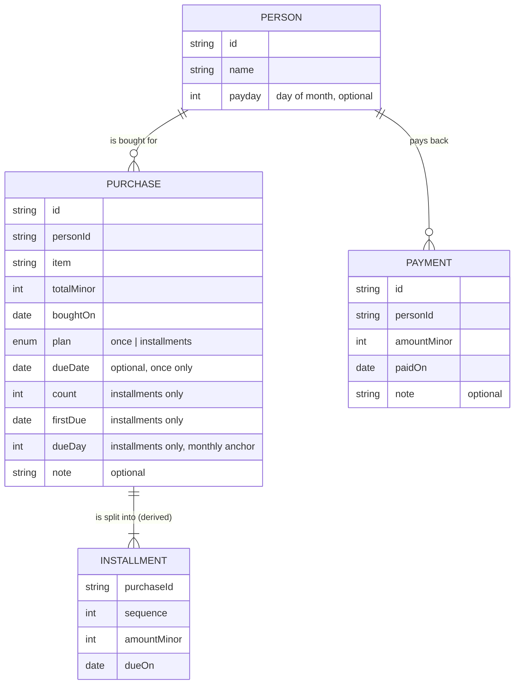
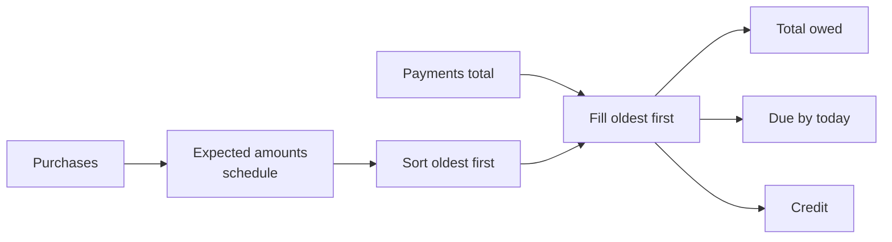
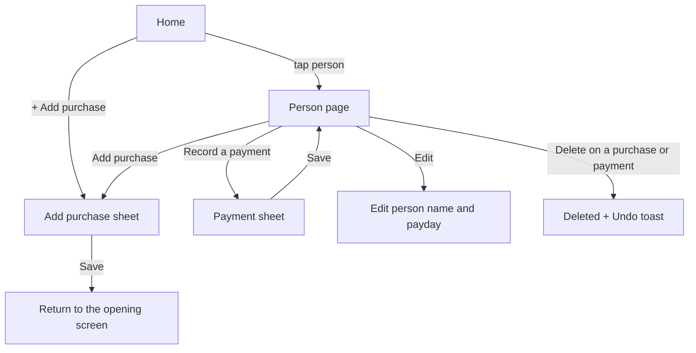

# Family Tab: Design Doc

Status: draft, 2026-11-22

Family Tab is a small personal app for the person who buys things online for the whole family. It records what each family member owes for the things bought for them and works out the balance automatically. A purchase is paid back either all at once or in monthly installments, and payments can come whenever the person has money.

## 1. Problem

- One person (the buyer) places most of the family's online orders: household goods, personal items, anything bought over the internet.
- Each purchase is for a specific family member, or for the household.
- Repayment varies:
  - **All at once**, usually around the person's payday.
  - **In installments**, matching how the buyer paid the store (for example 6 monthly card installments).
- Due dates are loose. People pay whenever they can, often partial amounts that don't match any one purchase.
- Today the buyer works out balances by memory or by hand. With overlapping installments and partial payments this goes wrong easily.

## 2. Goals and non-goals

Goals:

1. With an existing person and default dates, adding a purchase takes under 15 seconds and uses at most five fields before Save.
2. Deleting a purchase or payment takes one tap, with undo. Correcting a purchase in v1 means deleting it and adding the corrected entry.
3. For each person the app always answers "how much do they owe me in total?" and "how much of that is due by today?"
4. Payments of any size work without having to tie them to a specific purchase.
5. Works on a phone, which is where purchases happen.
6. After initial SSO sign-in and download, the buyer can use the ledger offline. Changes sync to the server when a connection returns, and the buyer can open the same ledger on another device.

Non-goals (v1):

- Interest, late fees, or any form of lending money for profit.
- Real money movement, bank linking, or payment requests.
- Strict due-date enforcement, reminders that nag, or "late" shaming.
- Family accounts, shared access, and multi-user editing.
- Importing orders automatically from shops (see roadmap).

## 3. Users and use cases

| Who | Role | Main needs |
| --- | --- | --- |
| Buyer (owner) | Records everything | Fast add/remove, correct totals, history |
| Family member | Person repaying the buyer | Get their balance from the buyer |

User stories:

1. As the buyer, I just ordered a vacuum for Mom for 12,000 TL in 6 installments. I add it right after checkout.
2. As the buyer, I bought my sister shoes; she'll pay it back "on payday" or whenever she can.
3. Mom sends me 4,000 TL. I record it and the app spreads it over what she owes.
4. I entered a purchase twice. I delete one and the totals fix themselves.
5. At the start of the month I want to see how much is due from each person.
6. My sister asks "how much do I still owe you?" I show her balance from her person page.

## 4. Core concepts and data model

Key decisions:

- **The app derives installments on demand.** The schedule uses `totalMinor`, `count`, `firstDue` and `dueDay`. A one-time purchase produces a single scheduled amount with an optional date. Changing a purchase regenerates its schedule.
- **Payments belong to a person.** The buyer records who paid, how much and when in one form.
- **Money uses integer minor units** (kuruş or cents). Store positive, safely representable integers and keep sums exact even when they exceed the range of a JavaScript safe integer.
- **One currency per ledger** (default TRY). Set it when creating the ledger and keep it fixed for that ledger. Restoring a backup replaces both the currency and the records.
- **Household purchases** can use a regular person entry named "Household". Splitting a purchase among people is planned for v2.
- **Dates are calendar dates** stored as `YYYY-MM-DD`. Use the buyer's local date for today. Purchase and payment dates can be backdated through today. Due dates must be on or after the purchase date. Payday, when set, is a day from 1 through 31.

## 5. Balance rules

Compute balances from purchases and payments whenever either changes or the local date changes.

1. **Build the schedule.** Each purchase creates one or more scheduled amounts.
   - All at once: one amount, with the optional due date or none ("whenever they can").
   - Installments start on `firstDue`. Each date, including `firstDue`, uses `dueDay` clamped independently to that month's last day. Accept 2 to 120 installments, each worth at least one minor unit.
2. **Split evenly in minor units.** `base = floor(total / count)`. The remainder is spread one unit at a time over the first installments. 100.00 in 3 becomes 33.34, 33.33, 33.33, which always sums exactly to the total.
3. **Order oldest first.** Sort by due date, using the purchase date for undated amounts. Break ties by purchase date, purchase ID in lexicographic order, then installment sequence. An older undated amount can receive payment before a newer dated one.
4. **Apply payments oldest first.** Sum the person's recorded payments and fill scheduled amounts in that order, allowing partial fills. A payment can cover future installments. Recompute from the current purchases and payments after each change.
5. **Derive the numbers from the remaining amounts.**
   - **Left to pay** is the sum of all unpaid amounts for the person.
   - **Due by today** is the unpaid part of dated amounts due on or before today.
   - **Behind plan** applies if a dated amount due before today is still unpaid. Use a calm amber status.
   - **Due in the next month** is the unpaid part of dated amounts due after today through the same day next month, clamped to month end. **Coming up** lists the first eight unpaid amounts in that window using the same sort order across all people.
   - **Paid so far** is the sum of recorded payments, including any credit. **Credit** is the excess after filling every scheduled amount. It automatically applies to that person's next purchase.
   - Home sums each person's left to pay, due by today and due in the next month. Credit stays with the person who paid it.

Worked example, Mom (payday on the 15th):

| Purchase | Plan | Expected |
| --- | --- | --- |
| Robot vacuum, 12,000 TL | 6 × 2,000 TL from Sep 15 | Sep 15, Oct 15, Nov 15, Dec 15, Jan 15, Feb 15 |
| Kitchen towels, 349.50 TL | Once, no date | Bought Nov 18 |

Payments: 4,000 TL on Oct 16. On Nov 22:

- Sep and Oct installments are paid. Nov 15 (2,000 TL) is unpaid, so due by today = 2,000 TL.
- Total owed = 12,349.50 − 4,000 = 8,349.50 TL.
- Due in the next month = 2,000 TL for Dec 15.

Because payments aren't tied to purchases, deleting a purchase or a payment just re-runs the rules and every number stays consistent.

## 6. Screens and flows

### Home

- Headline: **Your family owes you X**.
- Two figures show **Due by today** and **Due in the next month**.
- One row per person shows their name, amount left and a status chip. In order, show credit if positive, "All paid" if nothing is left, the amount due by today if positive, the earliest unpaid future date if any, or "When they can". Include "Behind plan" in the chip when the person meets that rule.
- **Coming up** shows the person, item, date and remaining amount for each entry in the upcoming list.
- Show sync status when changes are pending, the app is offline, or the buyer needs to sign in or resolve a conflict. Locally saved changes appear in balances immediately.
- A floating **+ Add purchase** button, always reachable with the thumb.

### Add purchase (the most important flow)

Bottom sheet, one screen, no wizard:

1. **Who** – chips of existing people (preselected if opened from a person page or there is only one person), plus "+ New person" inline.
2. **What** – free text ("Vacuum cleaner").
3. **Total price** – numeric keyboard. Accepts both `1.250,50` and `1,250.50` under the amount parsing rules below.
4. **How they pay back** – segmented control:
   - *All at once* (default) has an optional date. Chips include No fixed date (default), Their payday (when set), End of month and In 2 weeks. A custom date can also be entered.
   - *In installments* offers count chips 2 / 3 / 4 / 6 / 9 / 12 / other, with 2 selected initially. The first due date defaults to the first payday on or after today, or one calendar month from today if payday is unset.

For installments, the live preview shows the count, first and last dates, and amount or range of amounts. Use "6 × 2,000 TL" when all six amounts are equal.

Purchase date defaults to today. Who, what and price are required. Date shortcuts use today's local date, even for a backdated purchase. Payday resolves to the chosen day clamped to the last day of each candidate month. The installment default keeps the payday as its monthly anchor, or today's day when payday is unset. Selecting a custom first due date uses its day as the anchor. Save the resolved dates and anchor on the purchase so changing someone's payday only changes defaults for new entries.

### Person page

- Figures show **Due by today**, **Left to pay**, **Paid so far** and any positive **Credit**.
- Buttons: **Record a payment** (primary), Add purchase.
- Purchases appear newest first. Each card shows the item, total, plan, progress by scheduled amount, amount left, earliest unpaid dated amount, "Show dates", and Delete. Progress and dates use the same allocation as the balance.
- Payments received, newest first, each with Delete.
- Remove person (asks to confirm, removes their purchases and payments, can be undone).

### Record a payment

- Quick chips fill the amount with **Due by today**, **Next installment amount** (the remaining amount on the earliest unpaid installment due after today) or **Everything** (all left to pay). Show chips for valid positive payment amounts and use **Due by today** as the default when available. Each chip sets the payment amount and uses the usual allocation order.
- Date (today) and optional note ("cash", "bank transfer").
- Hint: "Payments cover the oldest scheduled amounts first. Any extra becomes credit."

### Removing things

- Delete is a single tap on purchases and payments. Apply the deletion locally and hold its queued operation for seven seconds. **Undo** cancels the operation and restores the records with their original IDs. After a reload, offer Undo for the time remaining on the saved deadline.
- Removing a whole person asks for confirmation. Remove the person, purchases and payments together in one transaction on each side. Undo of a single purchase or payment requires its person to exist.
- Editing a purchase in v1 means delete and re-add. A real edit form comes in v2.

### Visual language

- Calm colours. Green for paid, amber for expected or behind plan. No red "late" for family members.
- Large, tabular-figure numbers; amounts are the content.
- Light and dark themes.

## 7. Platform and technical approach

### PWA and server

- Serve the installable PWA and an authenticated ledger API over HTTPS from the same origin. Use one buyer account per ledger. The server authorizes every read and write against that account and stores the synced ledger in SQLite on persistent storage.
- A service worker caches the app shell. IndexedDB stores the last synced ledger and a queue of pending operations, scoped to the signed-in buyer. Once set up, the buyer can reopen the app, read balances, add records and delete or undo while offline.
- Balance logic lives in a pure, framework-free module that takes the records and an explicit `today` date. The app computes balances from the last synced records plus pending local changes. The server stores records and sync metadata. It validates writes before committing them.

### Sign-in

- **Sign in with SSO** is the only sign-in action. Use one configurable OpenID Connect (OIDC) provider per deployment and delegate account and credential management to that provider. Allow access only to the configured buyer identity, identified by the verified issuer (`iss`) and subject (`sub`) pair. [OpenID Connect Core](https://openid.net/specs/openid-connect-core-1_0.html#ClaimStability)
- The server handles the OIDC authorization code flow with PKCE (`S256`), validates the callback and issues its own session in a `Secure`, `HttpOnly`, `SameSite=Lax` cookie. Keep provider tokens on the server and protect API writes against cross-site requests. [OpenID Connect Core](https://openid.net/specs/openid-connect-core-1_0.html#CodeFlowAuth), [OAuth 2.0 Security Best Current Practice](https://www.rfc-editor.org/rfc/rfc9700.html#section-2.1.1)
- Initial sign-in and download require a connection. If the server session expires, keep the cached ledger and pending operations available offline. Resume sync only after the same buyer signs back in through SSO. Signing out while connected ends the app session and clears the device's local ledger. If changes are pending, offer to sync first or ask the buyer to confirm discarding them.

### Sync

1. Persist each operation in IndexedDB before showing its effect. Generate stable IDs for records and operations on the client. Sync when the app is open after a local change, at startup, on returning to the foreground, and when the connection returns. Allow one sync cycle at a time across tabs on the same device.
2. Send operations in queue order and wait if the first remaining operation is an undoable deletion. Include the ledger generation each operation was created against. The server checks the generation, applies the operation and records its ID and result in one transaction. For an already committed ID, return the prior result even after a restore. A lost response and retry cannot record the payment twice.
3. Fetch a current full ledger snapshot with its generation, revision and per-record versions. Use the operation ID as the new version of each record it changes so later queued operations can refer to earlier ones. An update or deletion includes the version it was based on. Creating a purchase or payment requires its person to still exist. Deleting a person checks that the person, list of children and their versions still match what the buyer saw at confirmation.
4. If a precondition fails, stop at that operation and keep it and later changes on the device. Show the relevant server state and let the buyer discard the conflicting operation or confirm a revised action with a new operation ID. Recheck dependent operations after a resolution. Save the latest snapshot and remove acknowledged operations in one local transaction, then replay the remaining queue to rebuild the local view.

### Backup and restore

- **Export** a versioned JSON file with the currency, people, purchases and payments. Export includes the current local ledger, including pending changes, and works offline. Back up the server database separately for recovery after server data loss.
- **Restore** requires a connection and an empty local queue. Validate the backup, preview what will be replaced, and ask for confirmation. Use an operation ID for safe retries and replace the server ledger in one transaction only if its revision still matches the preview. After a successful restore, refresh the local copy from the server. Validation or write failures leave the ledger intact.
- Give the restored ledger a new generation. Operations from another device that were queued against the previous generation are held for the buyer to review against the restored ledger.

### Verification

- Test scheduling, allocation, amount parsing and backup validation. Exercise the PWA after an online setup with the network disabled, then reload and reconnect. Check that a retried payment is recorded once, undo works after a reload, another device sees synced changes, and a concurrent deletion or backup restore preserves conflicting local changes for review.
- Verify that only the configured SSO identity can access the ledger, that an expired session preserves offline changes until the buyer signs back in, and that signing out clears the cached ledger.

## 8. Edge cases

### Parsing amounts

Purchase and payment fields use the same rules. Trim surrounding whitespace and accept positive values using digits, `.` and `,`. When both separators appear, the rightmost is decimal and the other must form valid thousands groups. A repeated separator must form valid thousands groups. For a single separator, prefer decimal when the fraction fits the currency's precision. Otherwise accept it as a thousands separator if the grouping is valid. A valid grouping starts with one to three digits followed by groups of exactly three. Reject malformed values and excess fractional digits. Convert the digits directly to integer minor units, padding the fractional part to the currency's precision. Show the interpreted amount in the ledger's currency format before Save.

### Ledger cases

| Case | Behaviour |
| --- | --- |
| Installment day 31 with a first payday in February | February uses its last day and March uses the 31st |
| Total not divisible by count | Remainder spread over the first installments, sum stays exact |
| Purchase amount below the installment count in minor units | Reject the plan and ask for a smaller count |
| Unpaid installment due today | Included in Due by today and excluded from Behind plan and Due in the next month |
| Payment larger than everything owed | Shown as credit, applied to future purchases |
| Payment deleted | Recompute balances. Installments previously shown as paid may become unpaid again |
| Purchase deleted after partial payment | Payment moves to the next oldest amount, or becomes credit |
| Undated one-time purchase | Included in Left to pay and excluded from date-based totals |
| `1.500` in a TRY ledger | Parsed as 1,500 TL and shown in the ledger's currency format |
| `12,50.00` in a TRY ledger | Rejected because the thousands group has two digits |

## 9. Open questions

1. How should v2 split a purchase among people, including any remainder from an uneven split?
2. When v2 lets a payment target a purchase, how should it allocate any excess?
3. Which balances and details should a shared summary or view-only link reveal?
4. Is an optional, gentle monthly summary ("Mom: 2,000 TL due this month") wanted, or no notifications at all?
5. Should installment purchases also record the store's card installment plan, so the buyer can match it against their credit card statement?

## 10. Roadmap

| Phase | Scope |
| --- | --- |
| v1 – MVP | People, purchases (once / installments), payments, oldest-first balances, home and person pages, delete + undo, installable offline PWA, SSO-only sign-in, server sync across devices, JSON backup |
| v2 | Edit purchases, split purchases between people, target payments to a purchase, search and filter, archive settled purchases |
| v3 | View-only family links, shareable "what you owe" summary, optional monthly reminder |
| Later | Attach the order screenshot or receipt, import from shop order emails, statistics (spending per person per month) |
