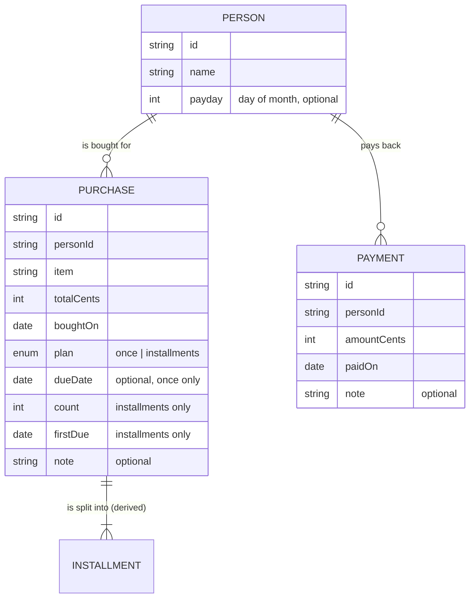
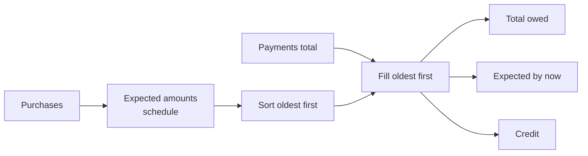
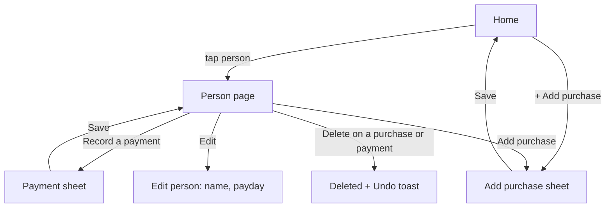

# Family Tab: Design Doc

Status: draft, 2026-11-22

Family Tab is a small personal app for the person who buys things online for the whole family. It records what each family member owes for the things bought for them and works out the balance automatically. A purchase is paid back either all at once or in monthly installments, and payments can come whenever the person has money.

## 1. Problem

- One person (the buyer) places most of the family's online orders: household goods, personal items, anything bought over the internet.
- Each purchase is for a specific family member, or for the household.
- Repayment varies:
  - **All at once**, usually around the person's payday.
  - **In installments**, matching how the buyer paid the store (for example 6 monthly card installments).
- Due dates are loose. People pay whenever they can, often partial amounts that don't match any one purchase.
- Today the buyer works out balances by memory or by hand. With overlapping installments and partial payments this goes wrong easily.

## 2. Goals and non-goals

Goals:

1. Adding a purchase takes under 15 seconds and at most 5 inputs.
2. Removing or fixing a mistake takes one tap, with undo.
3. For each person the app always answers "how much do they owe me in total?" and "how much should they have paid by now?"
4. Payments of any size work without having to tie them to a specific purchase.
5. Works on a phone, which is where purchases happen.

Non-goals (v1):

- Interest, late fees, or any form of lending money for profit.
- Real money movement, bank linking, or payment requests.
- Strict due-date enforcement, reminders that nag, or "late" shaming.
- Multi-user editing. Family members may view, only the buyer edits.
- Importing orders automatically from shops (see roadmap).

## 3. Users and use cases

| Who | Role | Main needs |
| --- | --- | --- |
| Buyer (owner) | Records everything | Fast add/remove, correct totals, history |
| Family member | Debtor, optional viewer | See what they owe and what is left |

User stories:

1. As the buyer, I just ordered a vacuum for Mom for 12,000 TL in 6 installments. I add it right after checkout.
2. As the buyer, I bought my sister shoes; she'll pay it back "on payday" or whenever she can.
3. Mom sends me 4,000 TL. I record it and the app spreads it over what she owes.
4. I entered a purchase twice. I delete one and the totals fix themselves.
5. At the start of the month I want to see who should have paid what by now.
6. My sister asks "how much do I still owe you?" I look at her page, or send her a view-only link.

## 4. Core concepts and data model

Key decisions:

- **Installments are derived, not stored.** The schedule is computed from `totalCents`, `count` and `firstDue`. Changing a purchase never leaves orphaned installment rows.
- **Payments belong to a person, not to a purchase.** This matches reality ("Mom sent me 4,000") and keeps recording a payment to one step.
- **Money is stored as integer minor units** (kuruş or cents). No floating point.
- **One currency per app** (default TRY), set in settings.
- **Household purchases**: model "Household" as a person, or split (see open questions).

## 5. Balance rules

The core of the app. All numbers shown are computed from these rules; nothing is stored as a running balance.

1. **Build the schedule.** Each purchase becomes one or more expected amounts:
   - All at once: one amount, with the optional due date or none ("whenever they can").
   - Installments: `count` amounts, monthly from `firstDue`, keeping the same day of month (clamped to month end, so Jan 31 becomes Feb 28).
2. **Split evenly in minor units.** `base = floor(total / count)`. The remainder is spread one unit at a time over the first installments. 100.00 in 3 becomes 33.34, 33.33, 33.33, which always sums exactly to the total.
3. **Order oldest first.** Sort expected amounts by due date. An amount with no date uses its purchase date.
4. **Apply payments oldest first.** Sum all of the person's payments and fill the expected amounts in order, allowing partial fills.
5. **Derive the numbers:**
   - Total owed = sum of all expected amounts − sum of payments (never below 0).
   - Expected by now = unpaid part of amounts whose due date is today or earlier. Undated amounts never count here.
   - Behind plan = unpaid part of amounts whose due date has passed. Shown softly (amber, "behind plan"), never as an error, because dates are flexible.
   - Credit = payments beyond everything owed. Carried forward automatically to the next purchase.

Worked example, Mom (payday on the 15th):

| Purchase | Plan | Expected |
| --- | --- | --- |
| Robot vacuum, 12,000 TL | 6 × 2,000 TL from Sep 15 | Sep 15, Oct 15, Nov 15, Dec 15, Jan 15, Feb 15 |
| Kitchen towels, 349.50 TL | Once, no date | Bought Nov 18 |

Payments: 4,000 TL on Oct 16. On Nov 22:

- Sep and Oct installments are paid. Nov 15 (2,000 TL) is unpaid, so expected by now = 2,000 TL.
- Total owed = 12,349.50 − 4,000 = 8,349.50 TL.

Because payments aren't tied to purchases, deleting a purchase or a payment just re-runs the rules and every number stays consistent.

## 6. Screens and flows

### Home

- Headline: **Your family owes you X**.
- Two figures: Expected by now, Due in the next month.
- One row per person: name, amount left, a status chip ("2,000 TL expected", "Next Dec 15", "When they can", "All paid").
- Coming up: the next 8 dated amounts across everyone.
- A floating **+ Add purchase** button, always reachable with the thumb.

### Add purchase (the most important flow)

Bottom sheet, one screen, no wizard:

1. **Who** – chips of existing people (preselected if opened from a person page or there is only one person), plus "+ New person" inline.
2. **What** – free text ("Vacuum cleaner").
3. **Total price** – numeric keyboard. Accepts both `1.250,50` and `1,250.50`.
4. **How they pay back** – segmented control:
   - *All at once* (default): optional date. Chips: No fixed date (default), Their payday, End of month, In 2 weeks.
   - *In installments*: count chips 2 / 3 / 4 / 6 / 9 / 12 / other, and the first installment date (defaults to their next payday, otherwise one month from today).
5. Live preview line: "6 × 2,000 TL every month, from 15 Dec to 15 May."

Purchase date defaults to today and sits to the side. Required inputs: who, what, price. Everything else has a sensible default.

### Person page

- Figures: Expected by now, Left to pay, Paid so far.
- Buttons: **Record a payment** (primary), Add purchase.
- Purchases, newest first. Each card shows item, total, plan, a segmented progress bar (one segment per installment), amount left, next date, "Show dates", and Delete.
- Payments received, newest first, each with Delete.
- Remove person (asks to confirm, removes their purchases and payments, can be undone).

### Record a payment

- Amount, prefilled with "expected by now" if there is one. Quick chips: Expected by now, Next installment, Everything.
- Date (today) and optional note ("cash", "bank transfer").
- Hint: "Any amount works. It pays off the oldest purchase first."

### Removing things

- Delete is a single tap on purchases and payments, followed by a 7-second **Undo** toast. No "are you sure" dialogs for single items.
- Only removing a whole person asks for confirmation, because it removes many records at once.
- Editing a purchase in v1 means delete and re-add. A real edit form comes in v2.

### Visual language

- Calm colours. Green for paid, amber for expected or behind plan. No red "late" for family members.
- Large, tabular-figure numbers; amounts are the content.
- Light and dark themes.

## 7. Platform and technical approach

| Option | Pros | Cons |
| --- | --- | --- |
| **A. PWA, local-first (recommended)** | One codebase, installs on the phone home screen, works offline, no server cost, data stays private | Sync between devices needs extra work; browser storage can be cleared |
| B. PWA + small backend (e.g. SQLite + API, or a hosted DB) | Multi-device sync, view-only family links, backups | Hosting, auth, more to maintain |
| C. Native mobile app | Best feel, notifications | Two platforms or a framework; store publishing; most effort |
| D. Spreadsheet with formulas | Zero build | Adding is slow on a phone, oldest-first allocation is awkward, easy to break |

Recommendation: start with **A**, designed so **B** can be added without changing the data model.

- Frontend: a lightweight framework (Svelte or React) with a mobile-first layout.
- Storage: IndexedDB through a thin repository layer (`people`, `purchases`, `payments`, `settings`).
- Balance logic: one pure, framework-free module (`schedule()`, `ledger(personId)`) with unit tests. This is the only part with real logic, so it gets the most tests.
- Backup: export/import JSON from settings in v1; sync in v2.
- Later sync: the same three collections map directly to a backend. IDs are client-generated so offline adds merge cleanly.

## 8. Edge cases

| Case | Behaviour |
| --- | --- |
| Installment day 31 in a short month | Clamped to the month's last day; later months return to the 31st |
| Total not divisible by count | Remainder spread over the first installments, sum stays exact |
| Payment larger than everything owed | Shown as credit, applied to future purchases |
| Payment deleted | Balances recomputed; earlier "paid" installments may become unpaid again |
| Purchase deleted after partial payment | Payment moves to the next oldest amount, or becomes credit |
| Undated "once" purchase | Never counts as expected or behind; still in the total owed |
| Ambiguous number like `1.500` | A single separator followed by exactly 3 digits is treated as a thousands separator (1,500) |
| Currency change | Display only; amounts aren't converted |

## 9. Open questions

1. Household items: one "Household" person, or split one purchase across several people (for example 3 ways)?
2. Should a payment optionally target a specific purchase ("this is for the shoes"), overriding oldest-first?
3. Do family members need their own view-only access, or is showing the screen or sending a summary enough? This decides whether v1 needs a backend.
4. Is an optional, gentle monthly summary ("Mom: 2,000 TL expected this month") wanted, or no notifications at all?
5. Should installment purchases also record the store's card installment plan, so the buyer can match it against their credit card statement?

## 10. Roadmap

| Phase | Scope |
| --- | --- |
| v1 – MVP | People, purchases (once / installments), payments, oldest-first balances, home and person pages, delete + undo, JSON backup, PWA install |
| v2 | Edit purchase, split purchases between people, payment targeted to a purchase, search and filter, archive of settled purchases |
| v3 | Sync across devices, view-only family links, shareable "what you owe" summary, optional monthly reminder |
| Later | Attach the order screenshot or receipt, import from shop order emails, statistics (spending per person per month) |
