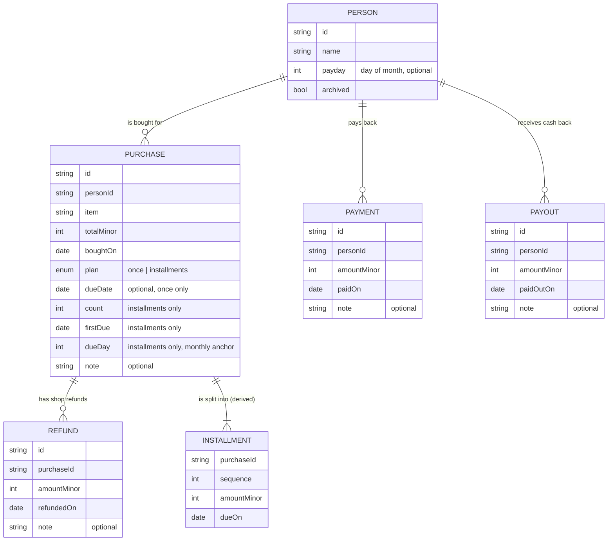
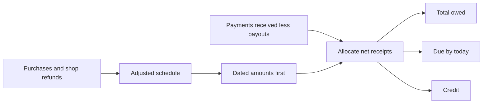
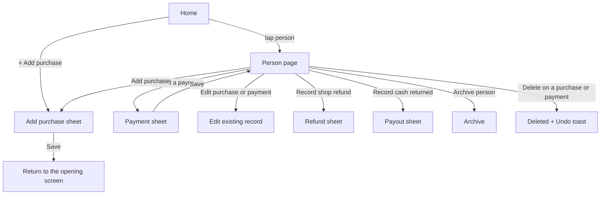

# Family Tab: Design Doc

Status — confirmed design, pending implementation

Family Tab is a small personal app for the person who buys things online for the whole family. It records what each family member owes for the things bought for them and works out the balance automatically. A purchase is paid back either all at once or in monthly installments, and payments can come whenever the person has money.

## 1. Problem

- One person (the buyer) places most of the family's online orders: household goods, personal items, anything bought over the internet.
- Each purchase is for a specific family member, or for the household.
- Repayment varies:
  - **All at once**, usually around the person's payday.
  - **In installments**, matching how the buyer paid the store (for example 6 monthly card installments).
- Due dates are loose. People pay whenever they can, often partial amounts that don't match any one purchase.
- Today the buyer works out balances by memory or by hand. With overlapping installments and partial payments this goes wrong easily.

## 2. Goals and non-goals

Goals:

1. With an existing person and default dates, adding a purchase takes under 15 seconds and uses at most five fields before Save.
2. The buyer can correct a purchase or payment in place. Eligible purchases and payments can be deleted in one tap, with undo.
3. For each person the app always answers "how much do they owe me in total?" and "how much of that is due by today?"
4. Partial payments and overpayments work at the person level. The ledger also accounts for shop refunds and cash returned to a family member.
5. Works on a phone, which is where purchases happen.
6. After initial SSO sign-in and download, the buyer can use the ledger offline. Changes sync to the server when a connection returns, and the buyer can open the same ledger on another device.

Non-goals (v1):

- Interest, late fees, or any form of lending money for profit.
- Real money movement, bank linking, or payment requests.
- Strict due-date enforcement, reminders that nag, or "late" shaming.
- Family accounts, shared access, and multi-user editing.
- Importing orders automatically from shops (see roadmap).

## 3. Users and use cases

| Who | Role | Main needs |
| --- | --- | --- |
| Buyer (owner) | Manages the ledger on their devices | Fast entry and correction, correct totals, history |
| Family member | Person repaying the buyer | Get their balance from the buyer |

User stories:

1. As the buyer, I just ordered a vacuum for Mom for 12,000 TL in 6 installments. I add it right after checkout.
2. As the buyer, I bought my sister shoes; she'll pay it back "on payday" or whenever she can.
3. Mom sends me 4,000 TL. I record it and the app spreads it over what she owes.
4. I entered a purchase twice. I delete one and the totals fix themselves.
5. At the start of the month I want to see how much is due from each person.
6. My sister asks "how much do I still owe you?" I show her balance from her person page.
7. The shop refunds part of Mom's vacuum after she has paid. I record the shop refund, then record a payout when I return some of her credit.

## 4. Core concepts and data model

Key decisions:

- **The app derives a base schedule and an adjusted schedule.** The base schedule uses `totalMinor`, `count`, `firstDue` and `dueDay`. A one-time purchase produces a single scheduled amount with an optional date. The adjusted schedule accounts for shop refunds. The base schedule remains visible in purchase history.
- **Payments and payouts belong to a person.** A payment records money received from that person. A payout records money returned to them. A shop refund belongs to a purchase and can be recorded separately from any payout.
- **V1 uses TRY.** Store positive, safely representable integer amounts in kuruş. Keep totals exact even when they exceed the range of a JavaScript safe integer.
- **Household purchases** can use a regular person entry named "Household". The amount appears under Household and in Home totals. Individual balances use their own ledger entries.
- **Dates are calendar dates** stored as `YYYY-MM-DD`. Store one ledger time zone, defaulting to the buyer's time zone at setup. All devices use it for today and date shortcuts. Purchase, payment, shop refund and payout dates can be backdated through today. Due dates and refund dates must be on or after the purchase date. Payday, when set, is a day from 1 through 31.

## 5. Balance rules

Compute balances from the current records whenever a record changes or the date changes in the ledger time zone. Changes to existing records can reallocate earlier payments.

1. **Build the schedule.** Each purchase creates one or more scheduled amounts.
   - All at once: one amount, with the optional due date or none ("whenever they can").
   - Installments start on `firstDue`. Each date, including `firstDue`, uses `dueDay` clamped independently to that month's last day. Accept 2 to 120 installments, each worth at least one minor unit.
2. **Split evenly in minor units.** `base = floor(total / count)`. The remainder is spread one unit at a time over the first installments. 100.00 in 3 becomes 33.34, 33.33, 33.33, which always sums exactly to the total.
3. **Apply shop refunds.** Reduce the last installment first and work backward until the refund is exhausted. Keep the original amounts and due dates visible. Zeroed installments remain in the purchase history and contribute zero to the balance. A one-time purchase has only one amount to reduce. The total refunded for a purchase cannot exceed its price.
4. **Order dated amounts first.** Sort all dated amounts, including future ones, by due date. Then sort undated amounts by purchase date. Break ties by purchase date, purchase ID in lexicographic order, then installment sequence.
5. **Allocate net receipts.** Subtract payouts from payments received. If net receipts are positive, fill the adjusted scheduled amounts in order, allowing partial fills. If net receipts are negative, show their absolute value as a separate undated cash shortfall and use zero for allocation.
6. **Derive the numbers from the remaining amounts.**
   - **Left to pay** is the sum of unpaid purchase amounts and any cash shortfall.
   - **Due by today** is the unpaid part of dated amounts due on or before today.
   - **Behind plan** applies if a dated amount due before today is still unpaid. Use a calm amber status.
   - **Due in the next month** is the unpaid part of dated amounts due after today through the same day next month, clamped to month end. **Coming up** lists the first eight unpaid amounts in that window using the same sort order across all people.
   - **Payments received** and **Cash returned** show the gross totals for the two types of cash entries. **Credit** is the positive net receipts left after filling all purchase amounts. Credit automatically applies to that person's next purchase.
   - Home totals include archived people, with a separate subtotal for archived balances. Credit stays with the person who paid it.

A new payout is limited to the person's current credit. If a later correction leaves net receipts negative, save the correction and show the cash shortfall. A payout already made offline can exceed available credit by the time it reaches the server. Hold it for review and let the buyer explicitly confirm it as money already returned.

Worked example, Mom (payday on the 15th):

| Purchase | Plan | Expected |
| --- | --- | --- |
| Robot vacuum, 12,000 TL | 6 × 2,000 TL from Sep 15 | Sep 15, Oct 15, Nov 15, Dec 15, Jan 15, Feb 15 |
| Kitchen towels, 349.50 TL | Once, no date | Bought Nov 18 |

Payments: 4,000 TL on Oct 16. On Nov 22:

- Sep and Oct installments are paid. Nov 15 (2,000 TL) is unpaid, so due by today = 2,000 TL.
- Total owed = 12,349.50 − 4,000 = 8,349.50 TL.
- Due in the next month = 2,000 TL for Dec 15.

If a 600 TL purchase has three 200 TL installments and the shop refunds 150 TL, the adjusted schedule is 200, 200 and 50 TL. If a refund leaves 500 TL of credit and the buyer returns 300 TL, 200 TL of credit remains. If a correction changes payments received from 600 TL to 400 TL against 500 TL of payouts, the 100 TL cash shortfall increases Left to pay and leaves Due by today unchanged.

## 6. Screens and flows

### Home

- Headline: **Your family owes you X**.
- Two figures show **Due by today** and **Due in the next month**.
- One row per active person shows their name, amount left and a status chip. In order, show credit if positive, "All paid" if nothing is left, the amount due by today if positive, the earliest unpaid future date if any, or "When they can". Include "Behind plan" in the chip when the person meets that rule.
- Show the archived balance subtotal and link to the archive. Home totals and Coming up include archived people, with an archive label on their upcoming entries.
- **Coming up** shows the person, item, date and remaining amount for each entry in the upcoming list.
- Show sync status when changes are pending, the app is offline, or the buyer needs to sign in or resolve a conflict. Locally saved changes appear in balances immediately. Include a **Sync now** action.
- A floating **+ Add purchase** button, always reachable with the thumb.

### Add purchase (the most important flow)

Bottom sheet, one screen, no wizard:

1. **Who** – chips of active people (preselected if opened from an active person's page or there is only one active person), plus "+ New person" inline.
2. **What** – free text ("Vacuum cleaner").
3. **Total price** – numeric keyboard. Accepts both `1.250,50` and `1,250.50` under the amount parsing rules below.
4. **How they pay back** – segmented control:
   - *All at once* (default) has an optional date. Chips include No fixed date (default), Their payday (when set), End of month and In 2 weeks. A custom date can also be entered.
   - *In installments* offers count chips 2 / 3 / 4 / 6 / 9 / 12 / other, with 2 selected initially. The first due date defaults to the first payday on or after today, or one calendar month from today if payday is unset.

For installments, the live preview shows the count, first and last dates, and amount or range of amounts. Use "6 × 2,000 TL" when all six amounts are equal.

Purchase date defaults to today. Who, what and price are required. Date shortcuts use today in the ledger time zone, even for a backdated purchase. Payday resolves to the chosen day clamped to the last day of each candidate month. The installment default keeps the payday as its monthly anchor, or today's day when payday is unset. Selecting a custom first due date uses its day as the anchor. Save the resolved dates and anchor on the purchase so changing someone's payday only changes defaults for new entries.

### Person page

- Show **Due by today**, **Left to pay**, **Payments received**, **Cash returned**, and any positive **Credit**. Itemize any cash shortfall under Left to pay.
- Offer **Record a payment** as the primary action. Offer **Add purchase** for active people and **Record cash returned** when there is credit.
- Purchases appear newest first. Each card shows the item, original total, refunds, plan, progress, amount left and earliest unpaid dated amount. **Show dates** includes both schedules. The card offers Edit, Delete and Record shop refund where applicable.
- Show incoming payments and payouts in dated history. Offer Edit and Delete on payments.
- **Archive person** explains any outstanding balance before confirmation and preserves their records. The archive allows payments, shop refunds, and payouts. Restore the person before moving or adding a purchase to their ledger.

### Record a payment

- Quick chips fill the amount with **Due by today**, **Next installment amount** (the remaining amount on the earliest unpaid installment due after today) or **Everything** (all left to pay). Show chips for valid positive payment amounts and use **Due by today** as the default when available. Each chip sets the payment amount and uses the usual allocation order.
- Date (today) and optional note ("cash", "bank transfer").
- Hint — "Payments cover dated amounts first, starting with the earliest due. Any extra becomes credit."

### Corrections and refunds

- Open the existing purchase or payment in its form to edit it. Keep its ID and recompute balances for everyone affected when the edit is saved.
- Record a shop refund from its purchase with an amount, date and optional note. Show refunds in purchase history and offer correction or removal there. Block changes that would leave refunds above the purchase total or before the purchase date. Review and remove linked shop refunds before deleting the purchase.
- Record cash returned from the person's page with an amount, date and optional note. Show the available credit before saving. Allow corrections to payout records and check available credit against any increase. Recording the shop refund and recording the cash payout are separate actions.
- Delete eligible purchases and payments in one tap. Apply the deletion locally and hold the queued operation for seven seconds. **Undo** cancels it and restores the records with their original IDs. After a reload, offer Undo for the time remaining on the saved deadline.

### Visual language

- Calm colours. Green for paid, amber for expected or behind plan. No red "late" for family members.
- Large, tabular-figure numbers; amounts are the content.
- Light and dark themes.

## 7. Platform and technical approach

### PWA and server

- Self-host the PWA and API together over HTTPS on the same origin. The server authorizes every ledger read and write for the single configured buyer and stores the synced ledger in SQLite on persistent storage.
- A service worker caches the app shell. IndexedDB stores the last synced ledger and a queue of pending operations, scoped to the buyer. After setup the buyer can reopen the app, work with the ledger, and undo deletions while offline.
- Balance logic lives in a pure, framework-free module that takes the records and an explicit `today` date. The app computes balances from the last synced records plus pending local changes. The server stores records and sync metadata. It validates writes before committing them.

### Sign-in

- **Sign in with SSO** is the only sign-in action. Use one configurable OpenID Connect (OIDC) provider per deployment and delegate account and credential management to that provider. Allow access only to the configured buyer identity, identified by the verified issuer (`iss`) and subject (`sub`) pair. [OpenID Connect Core](https://openid.net/specs/openid-connect-core-1_0.html#ClaimStability)
- The server handles the OIDC authorization code flow with PKCE (`S256`), validates the callback and issues its own session in a `Secure`, `HttpOnly`, `SameSite=Lax` cookie. Keep provider tokens on the server and protect API writes against cross-site requests. [OpenID Connect Core](https://openid.net/specs/openid-connect-core-1_0.html#CodeFlowAuth), [OAuth 2.0 Security Best Current Practice](https://www.rfc-editor.org/rfc/rfc9700.html#section-2.1.1)
- Initial sign-in and download require a connection. If the server session expires, keep the cached ledger and pending operations available until sign-out. Resume sync only after the same buyer signs back in through SSO.
- Sign-out clears the local ledger and pending operations across tabs on that device. If there are pending changes, warn the buyer and require confirmation before discarding them. When connected, offer to sync first. When offline, keep only a local marker for pending server sign-out. Invalidate the server session as soon as the app can reconnect, and complete that sign-out before starting a new session or loading ledger data.

### Sync

1. Persist each operation in IndexedDB before showing its effect. Generate stable IDs for records and operations on the client. Sync after a local change, at startup, on returning to the foreground, when the connection returns, and on manual request. While open and connected, target a refresh every 30 seconds. Allow one sync cycle at a time across tabs on the same device.
2. Preserve the order of dependent operations. Hold undoable deletions until their deadlines. Include the ledger generation each operation was created against. The server checks the generation, applies the operation and records its ID and result in one transaction. For an already committed ID, return the prior result even after a restore. Retrying a committed payment preserves a single record.
3. Fetch a full ledger snapshot with its generation, revision and per-record versions. Use the operation ID as the version of each record it changes so later operations can refer to earlier ones. Updates and deletions include the version they were based on. Recheck cross-record rules on the server, including archive status for new purchases, linked refunds for purchase changes, and available credit for new payouts.
4. On a same-record conflict, show the local and server versions and ask the buyer which to keep. Hold conflicting operations and their dependents. Continue syncing independent changes. If an offline payout exceeds the remaining credit on the server, show the discrepancy and ask whether the cash was already returned. A confirmed payout uses a new operation ID. Recheck dependencies after each resolution.
5. Save the latest snapshot and remove acknowledged operations in one local transaction, then replay the applicable pending operations to rebuild the local view. Keep held changes visible in the conflict view. After sign-out, discard any in-flight results from the signed-out session.

### Backup and restore

- **Export** a versioned JSON file with TRY, the ledger time zone, people, purchases, payments, shop refunds and payouts. Include pending changes reflected in the local ledger and allow export offline. Keep unresolved conflicts available for review until resolved. Back up the server database separately for recovery after server data loss.
- **Restore** requires a connection and an empty local queue. Validate the backup, preview what will be replaced, and ask for confirmation. Use an operation ID for safe retries and replace the server ledger in one transaction only if its revision still matches the preview. After a successful restore, refresh the local copy from the server. Validation or write failures leave the ledger intact.
- Give the restored ledger a new generation. Operations from another device that were queued against the previous generation are held for the buyer to review against the restored ledger.

### Verification

- Test scheduling, allocation, refunds, payouts, archive totals, amount parsing and backup validation. Verify that devices in different time zones agree on the due date boundaries.
- Test the installed PWA on iPhone via Safari and Android via Chrome, and verify desktop browser access. After online setup, disable the network, make changes, reload, and reconnect. Check undo after reload, payment retry, refresh on another device, independent sync during a conflict, payout confirmation, and recovery of stale edits after a backup restore.
- Verify that only the configured SSO identity can access the ledger, that an expired session preserves offline changes, and that a confirmed offline sign-out clears local data and ends the server session when the app reconnects.

## 8. Edge cases

### Parsing amounts

Purchase, payment, refund and payout fields use the same rules. Trim surrounding whitespace and accept positive values using digits, `.` and `,`. When both separators appear, the rightmost is decimal and the other must form valid thousands groups. A repeated separator must form valid thousands groups. For a single separator, prefer decimal when the fraction fits within two digits. Otherwise accept it as a thousands separator if the grouping is valid. A valid grouping starts with one to three digits followed by groups of exactly three. Reject malformed values and excess fractional digits. Convert the digits directly to integer kuruş. Show the interpreted TRY amount before Save.

### Ledger cases

| Case | Behaviour |
| --- | --- |
| Installment day 31 with a first payday in February | February uses its last day and March uses the 31st |
| Total not divisible by count | Remainder spread over the first installments, sum stays exact |
| Purchase amount below the installment count in minor units | Reject the plan and ask for a smaller count |
| Unpaid installment due today | Included in Due by today and excluded from Behind plan and Due in the next month |
| Payment larger than everything owed | Shown as credit, applied to future purchases |
| Payment deleted | Recompute balances. Installments previously shown as paid may become unpaid again |
| Purchase deleted after partial payment | Reallocate the payment in dated-first order. Any excess becomes credit |
| Undated one-time purchase | Included in Left to pay and excluded from date-based totals |
| Purchase fully refunded after receiving a payment | The adjusted balance for the purchase is zero. Reallocate net receipts and show any excess as credit |
| Person archived while they still owe money | Keep their balance in Home totals and show it in the archive subtotal |
| `1.500` in a TRY ledger | Parsed as 1,500 TL and shown in the ledger's currency format |
| `12,50.00` in a TRY ledger | Rejected because the thousands group has two digits |

## 9. Later release design

### Split purchases

- Record one purchase and one schedule, with a share for each person. Default to equal shares and let the buyer enter exact amounts. Require the shares to add up to the price and distribute any remainder from an equal split in stable person ID order.
- Split the base schedule in integer kuruş. Across each installment the shares must sum to the original installment amount. Across all installments each person's amounts must sum to their agreed share. Round each installment's proportional allocation down, then distribute the residual units with both totals as constraints. Resolve equivalent allocations consistently by installment sequence and person ID.
- For example, split a 100 TL purchase equally between two people over three months. The installment totals are 33.34, 33.33 and 33.33 TL. One person can owe 16.67, 16.67 and 16.66 TL, while the other owes 16.67, 16.66 and 16.67 TL. Both owe exactly 50 TL.
- For a shop refund, default to a proportional split using the original shares and cap each person's refund at their remaining refundable amount. Allocate any remainder deterministically among shares with capacity. The buyer can provide exact amounts when a return was for just one person. Reduce the latest amounts first within each affected share and preserve the original schedule.

### Targeted payments

- A payment can target a purchase or the payer's own share of a shared purchase. Allocate targeted payments before general payments. Within a target, use the usual dated-first order. Add any excess to the general pool and then apply the usual allocation rules to all remaining amounts.
- Cap all allocation at the person's positive net receipts. Where payouts reduce that pool, use general receipts first to cover the payouts, then reduce the amounts available from targeted payments, newest first. Process multiple targeted payments in payment-date order, then by payment ID.
- Recompute allocations after a correction, refund, or newly targeted payment. If a target is removed or an edited split removes the payer's share, keep the payment on the person's ledger and treat it as a general payment. Any remaining excess becomes credit.

### Shareable summary

- The buyer previews a plain-text snapshot for one person and shares or copies it. Include Left to pay, Due by today, next unpaid future due date if present, and the as-of date in the ledger time zone. The recipient receives a fixed snapshot. Family Tab sign-in remains available to the buyer only.

### Monthly summary

- The buyer can opt in to an in-app monthly summary and choose a day from 1 through 31 in the ledger time zone. Clamp the day to the last day in shorter months.
- On or after that day, show the buyer the current due amounts and what remains scheduled through the end of the month. If they open the app later that month, show the summary then. Keep it visible until dismissed and apply dismissal to that ledger month across the buyer's devices. The next eligible month gets its own summary.

The later receipt and import work can revisit whether to store the shop's card schedule separately from the family repayment schedule.

## 10. Roadmap

| Phase | Scope |
| --- | --- |
| v1 – MVP | TRY ledger, purchases and payments with in-place edits, refunds and payouts, dated-first balances, archive, delete + undo, offline PWA, SSO-only sign-in, self-hosted cross-device sync, JSON backup |
| v2 | Split purchases between people, target payments to a purchase, search and filter |
| v3 | Shareable plain-text snapshots and the buyer's optional in-app monthly summary |
| Later | Attach the order screenshot or receipt, import from shop order emails, statistics (spending per person per month) |
